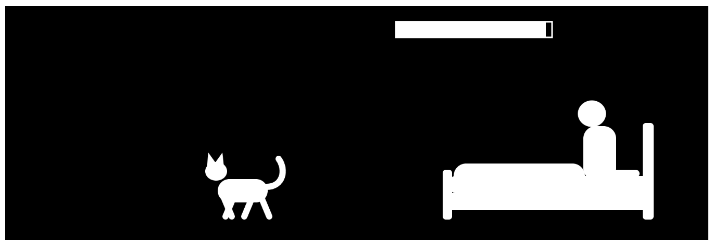

# Reflective Journel
## 2026.10.27
**CAT2**
> A continuation of last time's prototype! Refactored to remove repetitive drawing code & added in the game logic.

> The game parameters/user experience definitely still needs some tweaking for optimized experience - I found this to be the hardest part of game design...

**Makeup Salon**
> Taking on the role of the Math project in this week's prototype. This one's pretty light tho, just some trig to make that smooth eye movement.

> Using primitive shapes to draw person & items can be a bit challenging but happy about how it turned out!

**Bass**
> One more prototype added to the sound/instrument universe🤣. A very realistic interpretation. Hopefully it will be helpful and speed up me memorizing the fredboard.

> I struggled with using the envelop from the sound library. Example I found online are either old versions or not fully explaining. And I speculate that this was what caused sound to be played constantly instead of what I wanted (played only upon interaction and fade out). I ended up manually adjust the volume to have that single note sound.