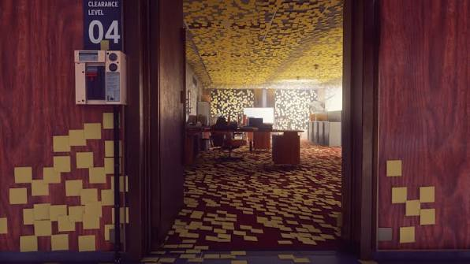

# Reflective Journel
## 2026.11.03
**Cafe**
> There are user experience components that I didn't have time to implement. The timer is a last-minute solution to show some sort of sense of scoring/feedback.

**Rhythm Game**
> I feel Arrays fit rhythm game if we look at music just as sequence of timestamps with stuff.

**Sticky Notes**
> The chill one, but my favorite one. 

> For next homework or the final project, I want to try do something more organic and less planned-out than most of my mini games, something chill in the design phase like this one but more fun during implementation, like psychedelic or funny visuals that I can't quite explain but it just happened.

> Inspo: 