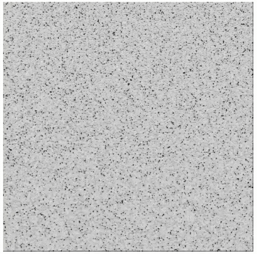
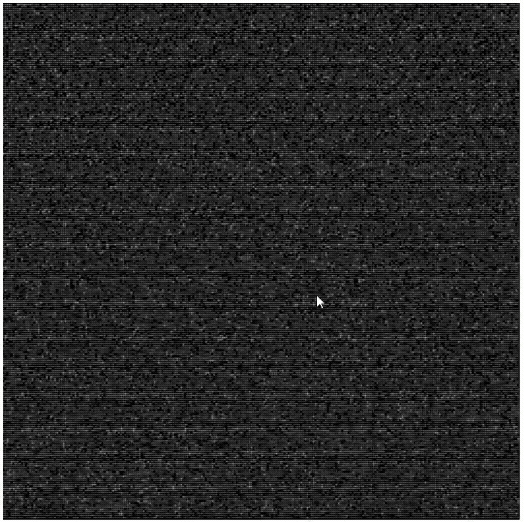
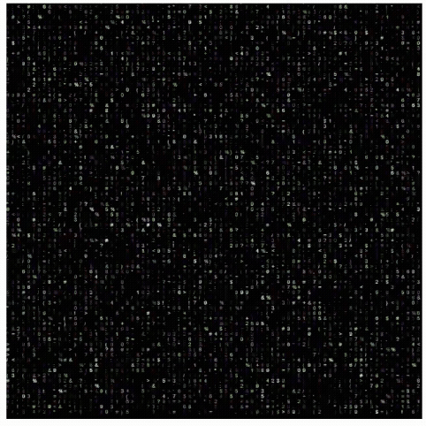
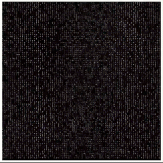
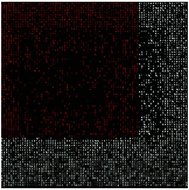

# Reflective Journel
## 2026.11.24
**Final Project**
> RandomMaxxing - using random in visuals

> + mouse color control

> this is when I feel I've reach a wall with my approaches, so I started to explore class examples.